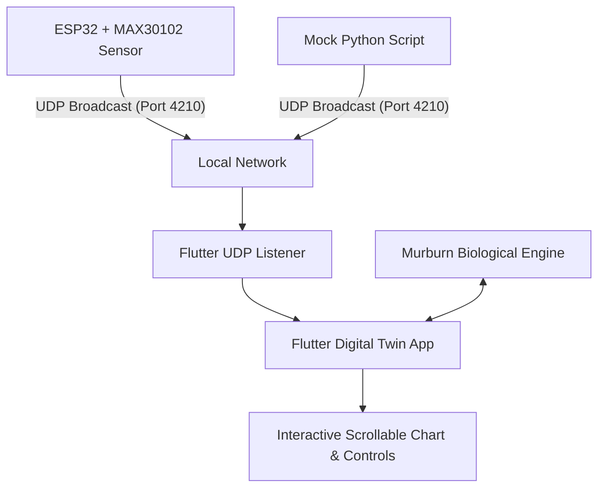

# Dilraksh - Hemodynamic Digital Twin

A full-stack cybernetic system merging IoT hardware data acquisition, UDP local network communication, biological modeling (the Murburn concept), and an interactive real-time Flutter dashboard.

---

## System Overview



1. **Hardware Node:** Reads heart rate (BPM) and blood oxygen (SpO2) from the MAX30102 sensor and broadcasts the telemetry as a CSV UDP packet (`"BPM,SpO2"`) on port 4210 every second.
2. **Mock Telemetry (Testing):** A Python script that broadcasts simulated physiological data to allow testing the dashboard without physical hardware.
3. **UDP Packet Listener:** An asynchronous Dart socket client that listens for packets on port 4210.
4. **Murburn Math Engine:** A Dart mathematical model representing cellular oxygen and thermodynamic demands under external heat, caffeine, and meal stressors.
5. **Cybernetic Dashboard:** A real-time, responsive dark-themed Flutter user interface displaying actual vs. predicted heart rates, the cybernetic error gap, and interactive stressor inputs.

---

## 1. Hardware Node (ESP32)

### Wiring Connections
Connect the **MAX30102** sensor to the **ESP32** using I2C:

| MAX30102 Pin | ESP32 Pin | Connection Type |
| :--- | :--- | :--- |
| **VCC** | **3.3V** | Power (3.3V) |
| **GND** | **GND** | Ground |
| **SDA** | **GPIO 21** | I2C Data |
| **SCL** | **GPIO 22** | I2C Clock |

### Uploading the Code
1. Open the [firmware.ino](file:///c:/Users/Admin/OneDrive/Desktop/Hemodynamic%20Digital%20Twin/firmware/firmware.ino) file in the Arduino IDE.
2. Install the **MAX30102** Library:
   - Go to **Sketch** -> **Include Library** -> **Manage Libraries...**
   - Search for **"SparkFun MAX3010x"** and click **Install**.
3. Update Wi-Fi credentials in `firmware.ino`:
   ```cpp
   const char* ssid = "YOUR_WIFI_SSID";
   const char* password = "YOUR_WIFI_PASSWORD";
   ```
4. Select your ESP32 Board and Upload. Check the Serial Monitor (Baud Rate: `115200`) to verify the Wi-Fi connection and sensor status.

---

## 2. Flutter Dashboard App

The app is built using Flutter and can run as a Desktop app (Windows, macOS, Linux) or a Mobile app (Android, iOS).

### Prerequisites
- Install [Flutter SDK](https://docs.flutter.dev/get-started/install).
- (Optional) Install Python 3 for running the mock simulator.

### Setup Instructions
1. Open your terminal in the `hemodynamic_twin_app/` directory.
2. Install Flutter packages:
   ```bash
   flutter pub get
   ```
3. Run the application:
   ```bash
   flutter run
   ```

---

## 3. Mock Telemetry Simulator (Testing)

If you don't have the ESP32 hardware or a MAX30102 oximeter, you can simulate transmission using python.

1. Open a terminal in the project directory.
2. Run the mock script:
   ```bash
   python hemodynamic_twin_app/mock_esp32.py
   ```
3. Start the Flutter app. It will immediately bind to the UDP port and display the simulated oximeter readings!

---

## 4. Murburn Biological Engine Math

The **Murburn concept** suggests that cellular respiration, heat production, and metabolic functions are governed by simple chemical/thermodynamic dynamics. In this app, we compute the **Theoretical Heart Rate** as:

$$\text{BPM}_{predicted} = \text{BPM}_{resting} + \Delta\text{BPM}_{temperature} + \sum\Delta\text{BPM}_{meal} + \sum\Delta\text{BPM}_{caffeine}$$

- **Base Resting HR:** 60.0 BPM.
- **External Temperature:** $+1.5\text{ BPM}$ for each $1^\circ\text{C}$ above $20^\circ\text{C}$.
  $$\Delta\text{BPM}_{temp} = 1.5 \cdot \max(0, T - 20)$$
- **Meal Size Stress ($S \in \{1,2,3\}$):** Cellular oxygen demand modeled as a bell curve peaking at 1 hour and resolving at 2 hours.
  $$\Delta \text{BPM}_{meal}(\Delta t) = 10 \cdot S \cdot \exp\left(-3 \cdot (\Delta t - 1.0)^2\right)$$
- **Caffeine ($C$ cups):** Exponential metabolic burn decaying over a 4-hour window.
  $$\Delta \text{BPM}_{caffeine}(\Delta t) = 8 \cdot C \cdot \exp\left(-0.576 \cdot \Delta t\right)$$
